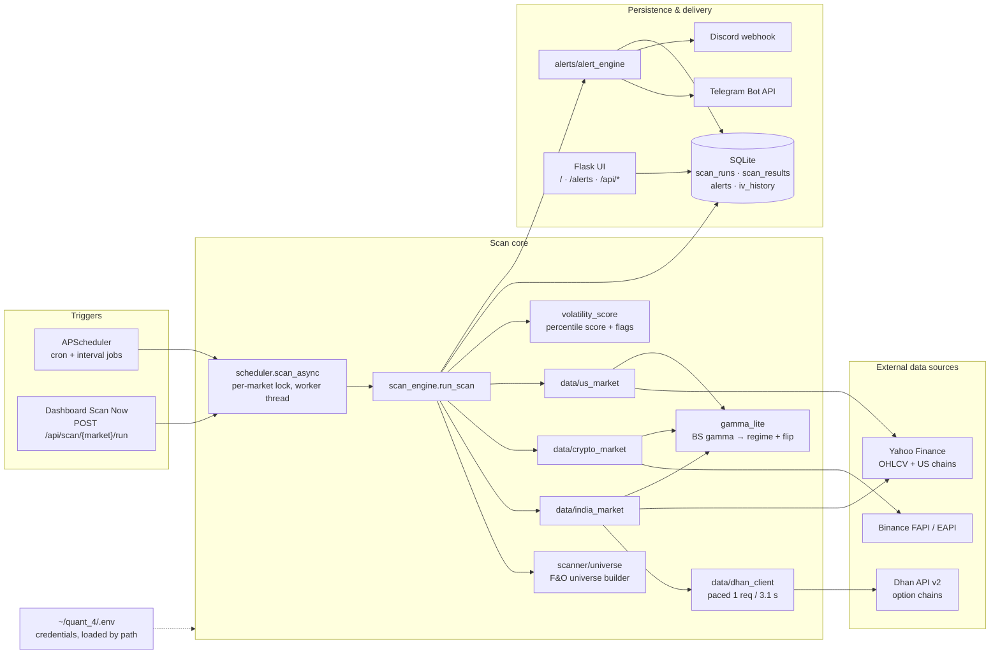
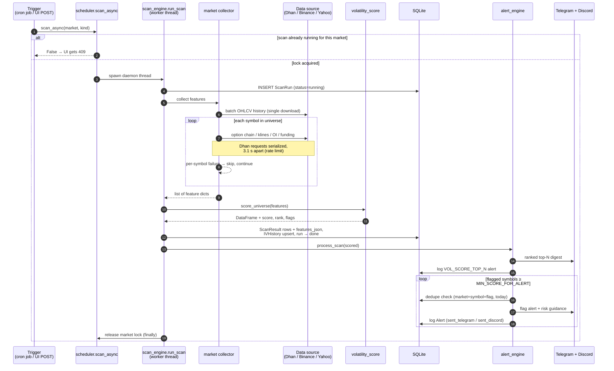
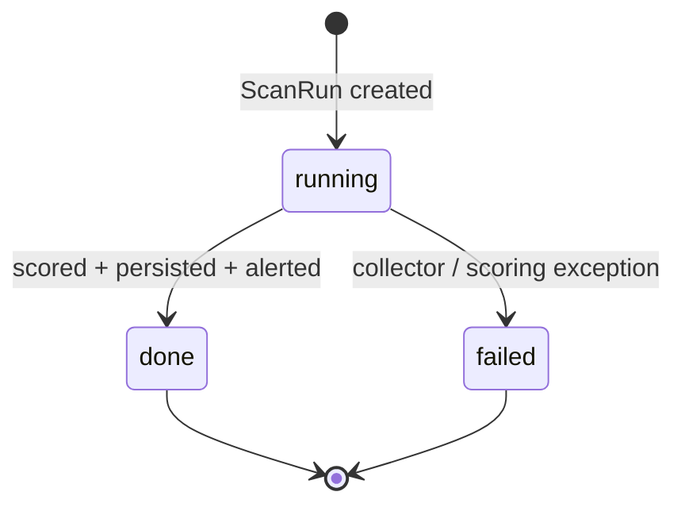
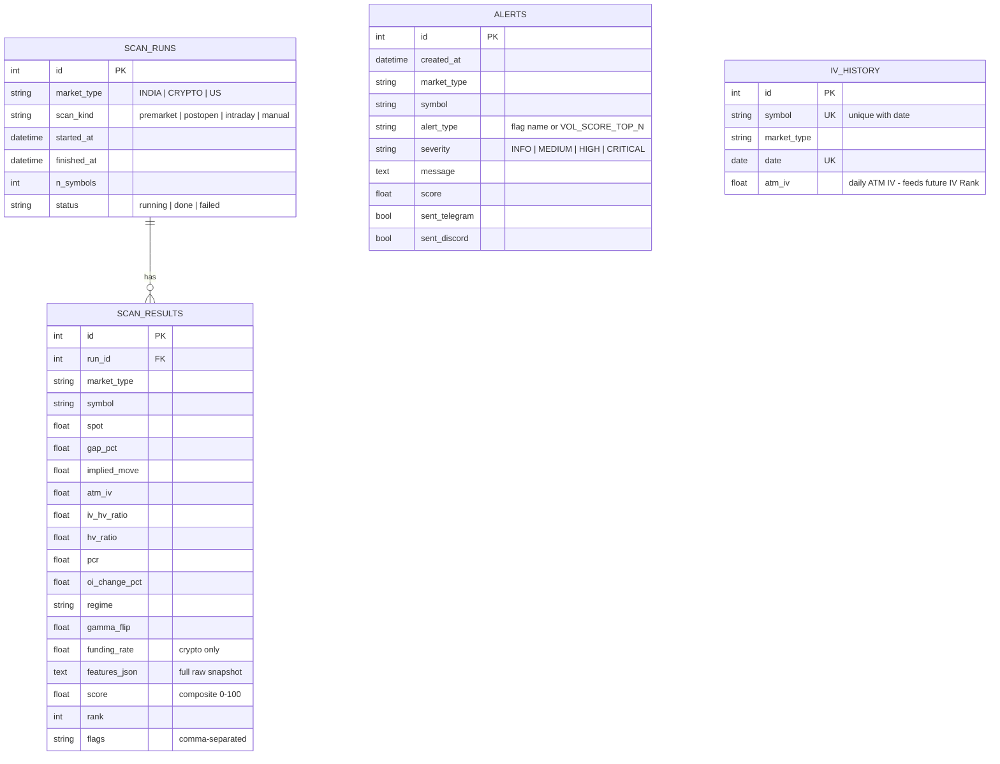
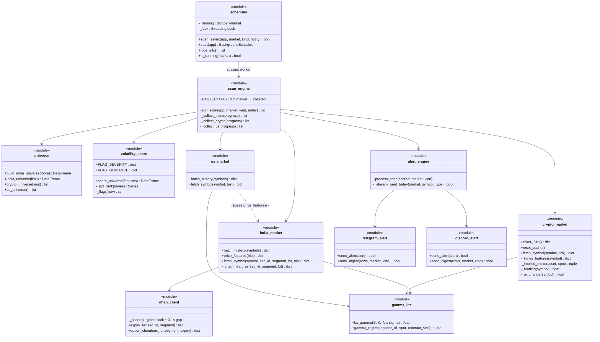

# Building a Cross-Market Pre-Market Volatility Scanner

*How `quant_alert` came together: a Flask app that ranks Indian F&O, crypto,
and US universes by expected volatility every morning and pushes ranked
digests to Telegram, Discord, and a web dashboard.*

---

## The problem

Most retail alerting tools poll one symbol at a time during the session and
tell you what already happened. The goal here was the opposite: a
**cross-sectional pre-market scan** that answers, before the open,
*"which names are likely to move violently today?"* — not as directional
calls, but as risk-awareness alerts ("expect a wide range, size down, use
wider stops, avoid market orders at the open").

Three markets, three very different data stacks:

| Market | Universe | Data source |
|---|---|---|
| India  | All F&O underlyings (4 indices + ~226 stocks) | Dhan API v2 option chains + yfinance OHLCV |
| Crypto | Top-40 USDT perpetuals by volume | Binance FAPI (perps) + EAPI (BTC/ETH/BNB options) |
| US     | 28 liquid tickers (SPY, QQQ, mega-caps…) | yfinance chains + history |

The project builds on an existing repo, `~/quant_4` (a per-symbol GEX/gamma
alert system), reusing its Dhan, Binance, Telegram, and Discord credentials
and extracting its Black-Scholes gamma math into a small `gamma_lite.py`.

## Signal design

Each symbol gets one feature row per scan, drawn from three signal families:

**Options-derived**

- **Straddle-implied move** — ATM call + put premium over spot is the
  market's priced expected move to expiry; dividing by √(days-to-expiry)
  normalizes it to a comparable 1-day number across expiries.
- **ATM IV** and the **IV/HV ratio** — implied vol versus 20-day realized
  vol. A ratio well above 1 means options are pricing something realized
  vol hasn't shown yet (an event, a repricing).
- **PCR** (put/call OI ratio) and **gamma regime**. The gamma regime
  (Positive/Negative) plus the flip level comes from cumulative signed
  gamma exposure across the chain: negative-gamma names gap harder because
  dealer hedging amplifies moves instead of damping them.

**Price/realized-vol derived (OHLCV)**

- **Gap %** vs the previous session close.
- **HV5/HV20 ratio** — short realized vol running hot against its baseline.
- **ATR%** and **distance to the 52-week high/low** (breakout proximity).

**Positioning**

- Total chain **open interest** and, for India, the **overnight ΔOI** —
  Dhan chain legs carry `previous_oi`, so one fetch yields the change.
- Crypto extras: **funding rate** (crowded-side proxy) and **24h OI change**
  from Binance futures data.

## Scoring: percentile ranks, not raw thresholds

Raw features live on wildly different scales (an implied move in percent, an
OI change in tens of percent, a PCR near 1). The V1 composite score
sidesteps unit problems entirely: every feature is converted to its
**cross-sectional percentile rank within the day's universe** (missing
values pinned to a neutral 0.5), then combined as a weighted sum scaled
0–100:

```python
SCORE_WEIGHTS = {
    "implied_move": 0.30, "gap_pct": 0.20, "iv_hv_ratio": 0.15,
    "hv_ratio": 0.15, "oi_change": 0.10, "negative_gamma": 0.10,
}
```

On top of the continuous score, hard-threshold **flags** fire per symbol:
`GAP_RISK` and `IMPLIED_MOVE_SPIKE` (high severity), `NEGATIVE_GAMMA_GAP`
(critical — a gap into negative dealer gamma), `IV_RANK_EXTREME`,
`HOT_REALIZED_VOL`, `OI_SPIKE`, and crypto-only `FUNDING_EXTREME`. Each flag
carries risk-guidance text rather than a trade direction.

Every scan also snapshots the full feature dict to a `features_json` column
and logs daily ATM IV to an `IVHistory` table — the training data for the
V2 plan (a true IV Rank once months of history accumulate, and eventually a
LightGBM ranker replacing the hand-set weights).

## Architecture

*(Diagrams are [Mermaid](https://mermaid.js.org/) — they render inline on
GitHub and in most markdown viewers. Pre-rendered copies for platforms that
don't render Mermaid live in [`docs/diagrams/`](docs/diagrams/), as both SVG
and 2× PNG: `architecture`, `scan-sequence`, `scanrun-states`, `data-model`,
`module-view`. After editing a diagram here, regenerate them with
`docs/render_diagrams.sh`.)*

### High-level view



### Module layout

```
app.py (Flask + SQLite)
 ├── scheduler.py            APScheduler cron/interval jobs, per-market run locks
 ├── scanner/
 │    ├── universe.py        Dhan instrument master → F&O universe CSV
 │    ├── scan_engine.py     orchestrates a scan run, persists results
 │    └── volatility_score.py  percentile scoring + flags
 ├── data/
 │    ├── dhan_client.py     globally paced Dhan wrapper (1 req / 3.1 s)
 │    ├── india_market.py    Dhan chains + yfinance OHLCV features
 │    ├── crypto_market.py   Binance FAPI/EAPI features
 │    └── us_market.py       yfinance chains + history features
 ├── alerts/                 telegram_alert.py, discord_alert.py, alert_engine.py
 └── templates/              dark-theme dashboard + alert history
```

Scheduling is timezone-explicit — the India jobs are cron-pinned to
`Asia/Kolkata` and the US job to `America/New_York`, so DST never shifts
the scan relative to the open:

- **India pre-market** 09:07 IST Mon–Fri (after the 09:00–09:07 pre-open
  auction, when chains reflect overnight IV repricing) and a **post-open
  rescan** at 09:20 IST with the actual opening print.
- **US pre-market** 09:10 ET Mon–Fri.
- **Crypto** every 30 minutes, 24/7.

Manual scans run via a **Scan Now** button (or `POST /api/scan/<MARKET>/run`)
on a worker thread guarded by a per-market lock — a second request while a
scan is running gets a 409, not a duplicate run.

After each scan the alert engine sends one ranked **digest** (top 10) to
Telegram and Discord, then individual flag alerts for symbols scoring above
`MIN_SCORE_FOR_ALERT` (the critical `NEGATIVE_GAMMA_GAP` is exempt from the
score gate). The same symbol + flag is deduped to once per market per day,
and everything is persisted to SQLite for the `/alerts` page.

### Scan lifecycle — sequence

One scan, from trigger to delivered alerts (identical for scheduled and
manual runs — both funnel through `scheduler.scan_async`):



A `ScanRun` row tracks each pass through a tiny state machine — any
exception in collection or scoring marks the run `failed` rather than
leaving it dangling:



## Data model

Four tables in SQLite (Flask-SQLAlchemy). `scan_results` is deliberately
wide — one denormalized feature row per symbol per scan, plus the complete
raw snapshot in `features_json` for future model training. Only the key
columns are shown here:



`alerts` doubles as the dedupe store — `_already_sent_today()` queries it
by market + symbol + alert_type + UTC day before sending. `iv_history` is
upserted once per symbol per day (unique constraint on symbol + date).

## Module / class view

The codebase is functional-style Python modules rather than deep class
hierarchies, so this is a module diagram with each module's public surface:



## The engineering problems worth writing down

### 1. Dhan's 1-request-per-3-seconds option-chain limit

Dhan's option-chain endpoint allows one unique request every 3 seconds. The
fix is a single global choke point: `dhan_client.py` wraps every call in a
`threading.Lock` plus a paced 3.1 s gap, so no matter how many code paths
ask for chains, requests are serialized and spaced. The consequence is a
hard scan-time budget — the full 226-stock universe would take ~12 minutes —
so `INDIA_UNIVERSE_LIMIT` (default 60) caps the scan to the 4 indices plus
the most liquid names first, keeping a pre-market scan under ~4 minutes.

The universe itself is built from Dhan's instrument master CSV: `FUTSTK`
rows identify every F&O underlying (with lot sizes), equity rows supply the
security IDs the option-chain API needs, and the result is cached to
`instance/fno_universe.csv`. A runtime fallback retries a failing chain
request on the alternate segment (`NSE_FNO` ↔ `NSE_EQ`), since a few
underlyings answer on the "wrong" one.

### 2. Yahoo's per-leg IVs are junk when you need them most

The scanner runs pre-market — exactly when yfinance's per-leg
`impliedVolatility` fields are degenerate. Inspection showed quantized
garbage (values like 0.0313 repeated across the whole chain) on 0DTE and
pre-market chains, producing "ATM IV" readings of 0.05%. A junk-filtered
band median still let bad values through.

The fix was to stop trusting per-leg IVs entirely and derive ATM IV from
the one thing that *is* real: the traded ATM straddle price, via the
**Brenner–Subrahmanyam approximation**:

```
σ ≈ straddle / (0.8 · S · √T)
```

The chain-median fallback only applies when there is no straddle print at
all. Result: NVDA came back at 34.5% instead of 0.78%.

### 3. "Gap %" that was always zero

Two subtle data bugs compounded here. During market hours, yfinance's daily
history ends with **today's partial bar**, so "previous close" was actually
the live price — gap ≡ 0. And when the market is closed, `fast_info`'s
last price *equals* the last close — gap ≡ 0 again. The fix:
`price_features()` drops the final bar whenever its date is today, and the
US spot lookup prefers `tk.info`'s `preMarketPrice` / `postMarketPrice` /
`regularMarketPrice` before falling back to `fast_info` and then history.
Sanity filters discard "gaps" beyond 20% (India) / 25% (US) as stale-data
artifacts.

### 4. Secrets stay out of the transcript

The credentials live in `~/quant_4/.env` and were never printed. The
convention adopted (and kept as persistent project memory): inspect
variable *names* only (`grep -oE '^[A-Za-z_]+' .env`) and let the app load
values by path — `config.py` calls `load_dotenv()` on `~/quant_4/.env`
first, with a local `.env` able to override any value.

### 5. Crypto implied moves without a real options market per alt

Binance only lists options on BTC, ETH, and BNB. So the crypto scan takes
implied moves from the EAPI mark-price endpoint (nearest-expiry ATM
straddle + `markIV`) for those three, and leans on the realized-vol,
funding, and OI-change features for the rest of the perp universe. A
per-scan cache avoids refetching the options mark table for each symbol.

## Verification status

- **Crypto**: fully verified live — a 40-symbol scan persisted, flags fired
  on genuine movers (one perp with a +68.5% gap), and both the Telegram and
  Discord digests delivered.
- **US**: features spot-checked against reality (SPY gap +0.37% vs true
  previous close, NVDA ATM IV 34.5%); scheduled for 09:10 ET.
- **India**: the code path mirrors quant_4's proven Dhan usage, but the
  access token in `~/quant_4/.env` was expired at build time (Dhan error
  808), so the live India scan awaits a token refresh at web.dhan.co.
  Dhan tokens expire periodically; this will be a recurring chore.

The app runs detached (`nohup … & disown`) so it survives terminal
sessions, serving the dashboard at `http://localhost:5050`.

## What's next

- **V1.5** — market-level context: India VIX and GIFT Nifty adjustment,
  an earnings-calendar `EVENT_DAY` override, futures OI buildup
  classification (long/short buildup vs unwinding).
- **V2** — a real IV Rank once `IVHistory` has a few months of data, and a
  LightGBM model trained on the logged `features_json` snapshots against
  realized next-day ranges, replacing the hand-tuned percentile weights.

---

*Stack: Python 3, Flask + Flask-SQLAlchemy (SQLite), APScheduler,
dhanhq 2.0.2, yfinance, pandas/numpy, Binance FAPI/EAPI, Telegram Bot API,
Discord webhooks.*
